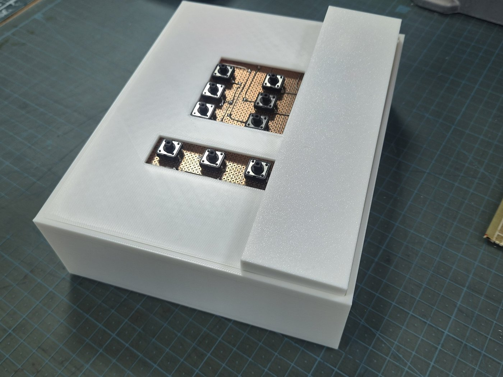
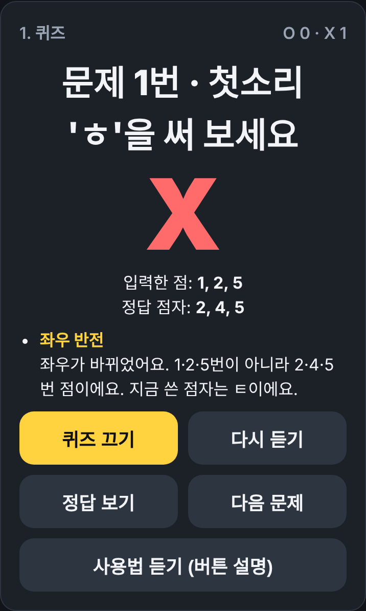
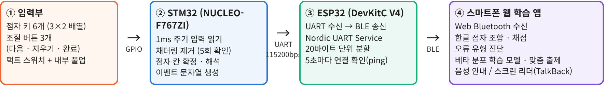
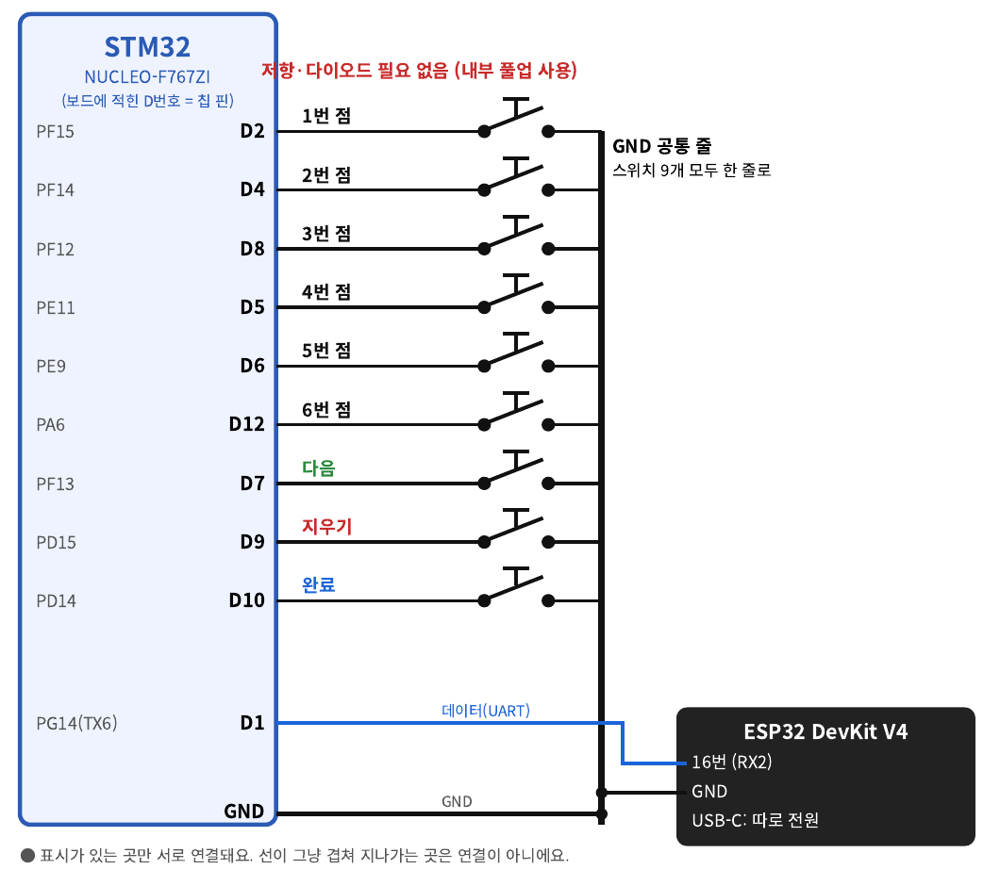
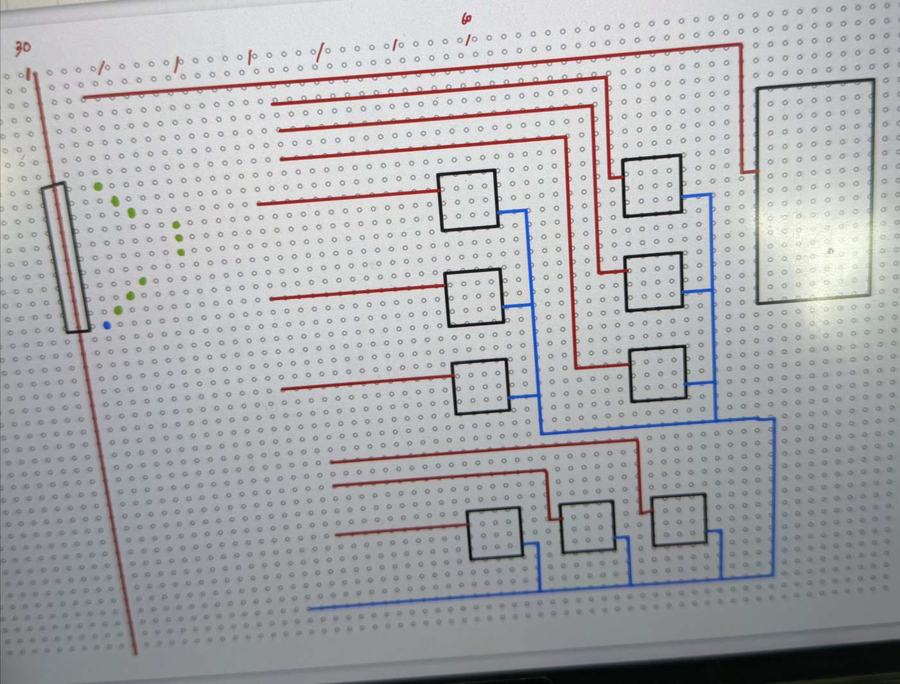
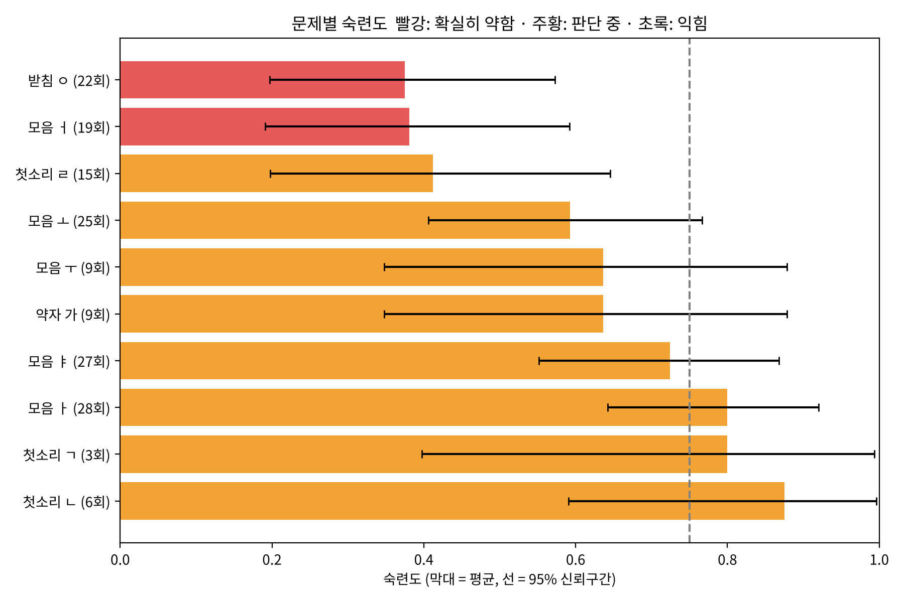
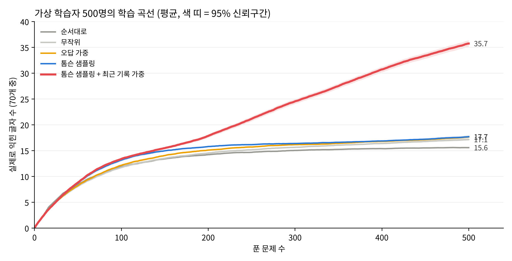
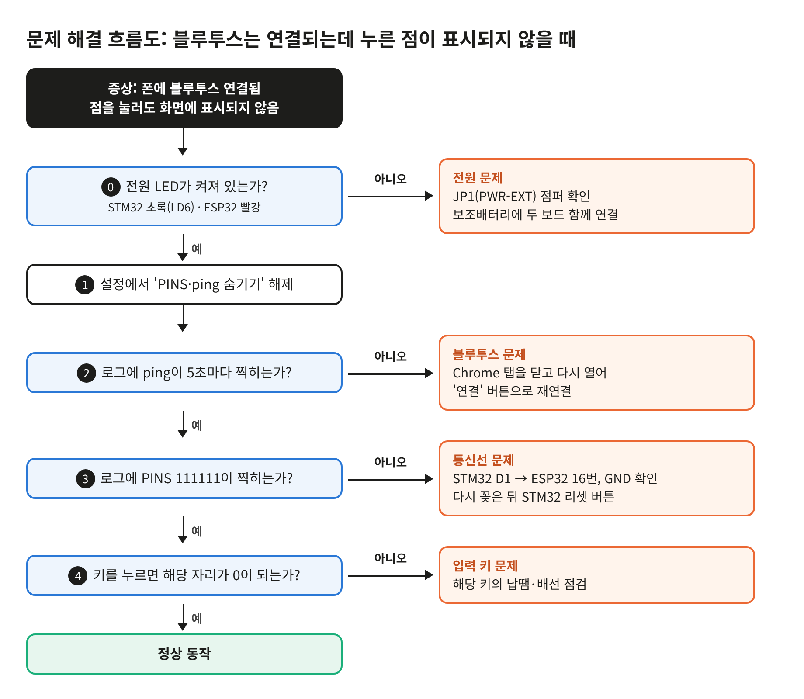

# 점자 쓰기 학습기

> 틀린 **이유**까지 알려 주는 저비용 점자 쓰기 학습 시스템
> 2026 공학교육 캡스톤디자인 경진대회 출품작

점자 한 칸 모양의 키 6개로 점자를 쓰면, 스마트폰이 채점하고 **"좌우가 바뀌었어요. 지금 쓴 점자는 ㅌ이에요"** 처럼 오류의 원인과 실제로 쓴 글자를 음성으로 알려 줍니다. 학습 기록은 베타 분포로 분석해 약한 글자를 자동으로 다시 출제합니다.

| | |
|---|---|
| 학습 사이트 | https://yejinee832.github.io/braille/ |
| 시연용 사이트 | https://yejinee832.github.io/braille/?demo |
| 시연 영상 | [docs/demo.mp4](docs/demo.mp4) (자막 포함, 약 6분) |
| 사용설명서 | [docs/manual.pdf](docs/manual.pdf) |

<p align="center">
  
  
</p>

---

## 시스템 구성

```
 [점자 키 6개 + 다음·지우기·완료]
            │  GPIO 9개 (내부 풀업)
            ▼
   STM32 NUCLEO-F767ZI ── 1ms 폴링 디바운싱, 점자 해석(109개)
            │  USART6 115200bps
            ▼
         ESP32 ── BLE(Nordic UART), 20바이트 단위 전송
            │  Web Bluetooth
            ▼
  스마트폰 Chrome 웹 앱 ── 한글 조합, 채점, 오류 진단, 음성, 학습 분석
```



## 주요 기능

- **오류 원인 진단**: 정답 여부가 아니라 *왜* 틀렸는지 알려 줍니다.
- **실제로 쓴 글자 안내**: "지금 쓴 점자는 ㅌ이에요"
- **맞춤 출제**: 베타 분포 숙련도와 톰슨 샘플링으로 약한 글자를 자주 냅니다.
- **단계 자동 진행**: 모음 → 첫소리 → 받침 → 약자 → 단어
- **화면 없이 사용**: 모든 안내를 음성으로 하고, 기기 버튼만으로 모드 이동, 정답 듣기, 사용법 듣기를 할 수 있습니다. TalkBack 모드도 지원합니다.
- **쉬운 연결**: 화면 아무 곳이나 누르면 연결되고, 끊기면 자동으로 다시 연결합니다.
- **설치 없음**: 웹 앱이라 스마트폰 Chrome만 있으면 됩니다. 기록은 폰에 저장되고 CSV로 내보낼 수 있습니다.

## 핵심 기술

### 1. 하드웨어와 펌웨어 ([firmware/](firmware/))

- 12mm 택트 스위치 9개를 **내부 풀업 입력**으로 연결해 외부 저항 없이 구성
- **1ms 폴링 + 5회 연속 확인 디바운싱**으로 채터링과 짧은 입력 누락 제거
- 누른 점을 **비트마스크 OR**로 모아, 점을 하나씩 눌러도 동시에 눌러도 같은 칸으로 인식
- 초성·종성·모음·약자·약어·영어 **109개 해석표**, 두 칸짜리 약어(PAIR) 처리

| 회로도 | 실제 납땜 |
|---|---|
|  |  |

### 2. 오류 진단 ([diagnose.js](diagnose.js))

점자 한 칸을 6개 점의 집합으로 보고 비교합니다.

| 오류 유형 | 판정 방법 |
|---|---|
| 좌우 반전 | 점 번호를 1↔4, 2↔5, 3↔6으로 바꾸면 정답 |
| 위아래 반전 | 점 번호를 1↔3, 4↔6으로 바꾸면 정답 |
| 초성·받침 혼동 | 같은 자음의 첫소리·받침 자리를 바꿔 씀 |
| 점 빠짐 / 점 추가 | 정답 집합과의 차집합 |
| 점 위치 틀림 / 다른 글자 | 차이가 2개 이하 / 그 이상 |
| 칸 빠짐 / 칸 추가 | 편집 거리(동적 계획법)로 입력 칸과 정답 칸 정렬 |

### 3. 베타 분포 학습 모델 ([learn.js](learn.js))

- 문제마다 Beta(1 + 맞음, 1 + 틀림)으로 숙련도와 **95% 신뢰구간** 계산
  → 1번 중 1번 맞힌 것과 30번 중 30번 맞힌 것을 구분
- '확실히 약함 / 아직 모름 / 익힘' 3가지로 분류해 리포트
- **톰슨 샘플링**: 각 문제의 베타 분포에서 값을 뽑아 가장 낮은 문제를 출제
- 단계 통과: 그 단계의 실력이 75%를 넘을 확률이 80% 이상



### 4. 가상 학습자 시뮬레이션 ([analysis/simulation/](analysis/simulation/))

점자를 처음 배우는 가상 학습자 500명(지식 추적 BKT + 망각 + 개인차)에게 출제 방식 5가지를 똑같은 조건으로 적용해 비교했습니다(짝지은 윌콕슨 검정, p < 0.001).
학습 속도·망각 속도 가정을 바꿔도 순위가 유지되는지 민감도 분석도 했습니다.



> 학습자 모델의 매개변수는 가정한 값이므로, 결과는 출제 방식 간 **상대적인 비교**로 해석해야 합니다. 실제 학습자 데이터로 검증하는 것이 다음 단계입니다.

## 비용

| 제품 | 가격 |
|---|---|
| 한소네6 (점자정보단말기) | 약 580만 원 |
| 탭틸로 (점자 학습기) | 약 182만 원 |
| **이 시제품** | **약 8~9만 원** (제어 보드 5~6만, 스위치·기판 4천, 케이스 3천, 보조배터리 2만) |
| 양산 목표 | 3~5만 원 (ESP32 단일 칩 통합, 전용 PCB, 내장 배터리) |

점자 출력 구동부와 화면·스피커를 빼고 스마트폰을 화면·음성·연산 장치로 써서 비용을 낮췄습니다.

## 문제 해결 기록

개발하면서 부딪힌 문제와 해결 과정입니다.

| 문제 | 원인 | 해결 |
|---|---|---|
| 빠르게 누르면 점이 빠짐 | 스위치 채터링, 짧은 입력 | 1ms 폴링 + 5회 연속 확인 디바운싱 |
| `No ST-LINK detected` / `No device found` | 업로드 시 타깃 연결 실패 | 디버그 설정 Connect under reset |
| 보조배터리로 STM32가 안 켜짐 | 외부 전원 점퍼 | JP1(PWR-EXT) 연결 |
| 보조배터리가 몇 초 뒤 꺼짐 | 소비 전류가 적어 자동 차단, 내장 케이블 접촉 불량 | 두 보드 함께 연결, 별도 케이블 사용 |
| BLE로 받은 한글이 깨짐 | 20바이트 단위로 쪼개져 도착 | TextDecoder 스트림 모드 + 줄바꿈 기준으로 다시 이어 붙임 |
| 긴 음성 안내가 중간에 끊김 | 고정된 대기 시간보다 음성이 길어 다음 안내가 덮어씀 | 문장 단위로 나눠 읽고, 음성이 끝난 뒤 다음 안내 |



## 폴더 구조

```
├── index.html          웹 앱 (화면, BLE 연결, 퀴즈, 음성)
├── compose.js          점자 칸 → 한글 조합 (약자·약어·된소리·겹받침)
├── diagnose.js         오류 진단 (집합 비교, 편집 거리)
├── learn.js            베타 분포 숙련도, 신뢰구간, 톰슨 샘플링, 단계 진행
├── firmware/
│   ├── stm32/          STM32 사용자 코드 (디바운싱, 해석표)
│   └── esp32/          UART → BLE 브리지
├── analysis/
│   ├── braille_beta_report.py   학습 기록 CSV → 베타 분석 그래프
│   └── simulation/              가상 학습자 시뮬레이션
└── docs/               사용설명서, 시연 시나리오, 시연 영상, 그림
```

## 만든 사람

- 팀 구성: 전자공학과 3명, 신소재공학과 1명
- 저장소 관리자: 아이디어 제안, 시스템 설계, 하드웨어·펌웨어·웹 앱 구현 및 통합
- 개발 과정에서 AI 도구(Claude)를 코드 작성과 문서 정리에 활용했습니다.
