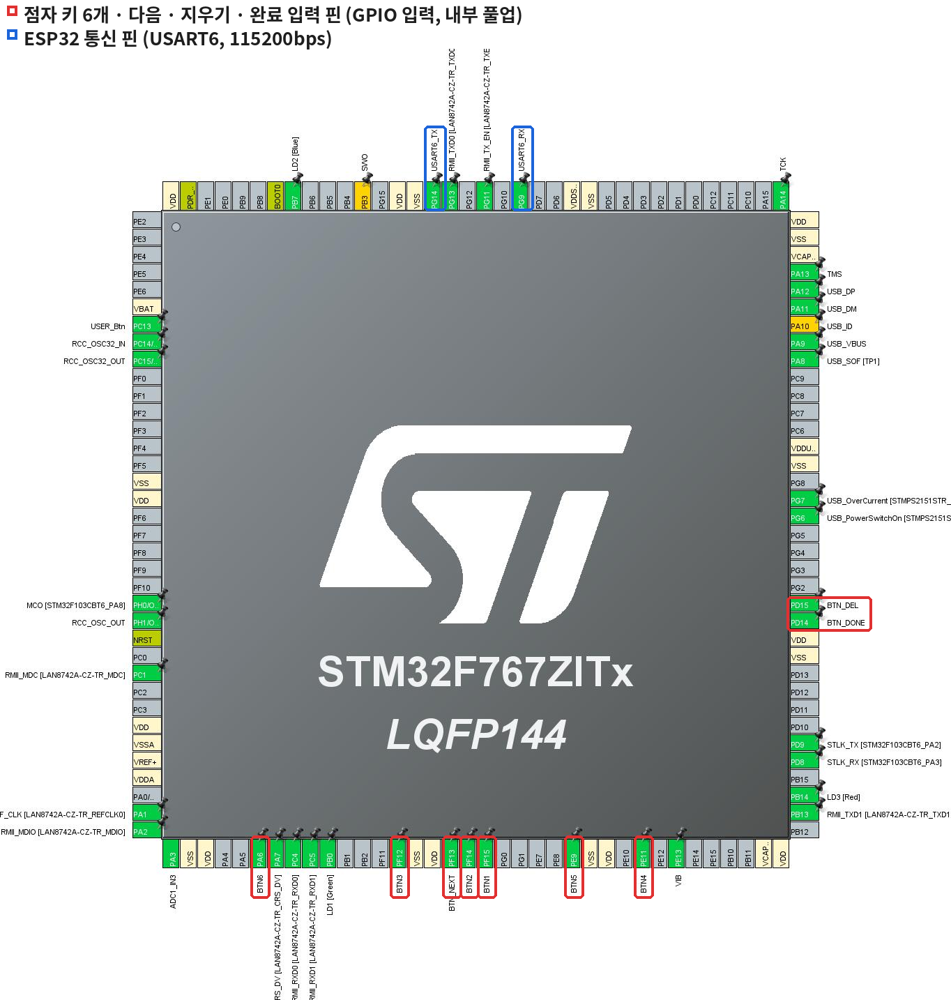

# 펌웨어

## 구성

| 폴더 | 보드 | 하는 일 |
|---|---|---|
| `stm32/` | STM32 NUCLEO-F767ZI | 키 9개 읽기, 디바운싱, 점자 해석, UART로 결과 보내기 |
| `esp32/` | ESP32 DevKit | UART로 받은 줄을 BLE(Nordic UART Service)로 스마트폰에 전달 |

## STM32 핀 설정 (STM32CubeMX)

모든 키는 **내부 풀업 입력**이라서, 누르면 0(LOW), 떼면 1(HIGH)이 됩니다.

| 키 | 보드 소켓 | 칩 핀 | 라벨 | 모드 |
|---|---|---|---|---|
| 1번 점 | D2 | PF15 | BTN1 | 입력, Pull-up |
| 2번 점 | D4 | PF14 | BTN2 | 입력, Pull-up |
| 3번 점 | D8 | PF12 | BTN3 | 입력, Pull-up |
| 4번 점 | D5 | PE11 | BTN4 | 입력, Pull-up |
| 5번 점 | D6 | PE9 | BTN5 | 입력, Pull-up |
| 6번 점 | D12 | PA6 | BTN6 | 입력, Pull-up |
| 다음 | D7 | PF13 | BTN_NEXT | 입력, Pull-up |
| 지우기 | D9 | PD15 | BTN_DEL | 입력, Pull-up |
| 완료 | D10 | PD14 | BTN_DONE | 입력, Pull-up |
| ESP32 송신 | D1 | PG14 | USART6_TX | UART 115200 8N1 |

- **USART3**: ST-LINK 가상 COM 포트 (PC 시리얼 모니터 확인용)
- **TIM2**: 1MHz(PSC 95), 키를 누른 시각을 µs 단위로 기록

## 입력 처리 방식

1. 1ms마다 키 9개를 읽습니다(폴링).
2. 같은 값이 **5번 연속**(5ms) 나와야 진짜로 바뀐 것으로 인정합니다. 스위치 채터링을 걸러 내는 디바운싱입니다.
3. 누른 점은 `dot_buffer`에 비트 OR로 모읍니다. 점을 하나씩 눌러도, 동시에 눌러도 같은 칸이 됩니다.
4. **다음** 버튼을 누르면 한 칸을 확정하고 해석표(109개)에서 찾아 `CELL`, `DEC`, `PAIR`를 보냅니다.

## 업로드할 때 주의

- 보조배터리로 쓸 때는 **JP1(PWR-EXT) 점퍼**를 꽂고, PC로 업로드할 때는 뺍니다.
- `No device found on target` 오류가 나면 디버그 설정에서 **Connect under reset**으로 바꿉니다.
